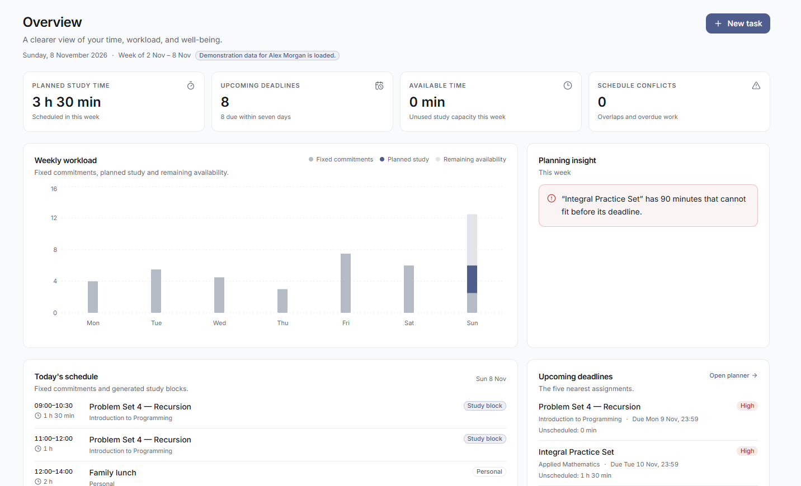
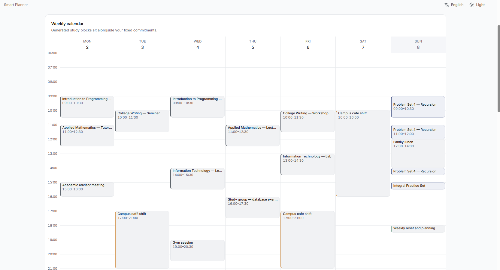
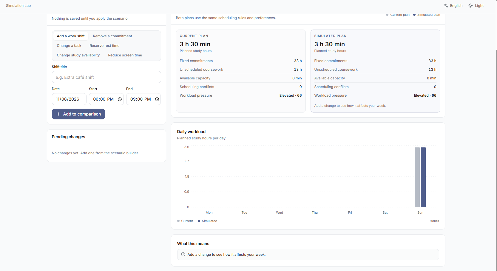
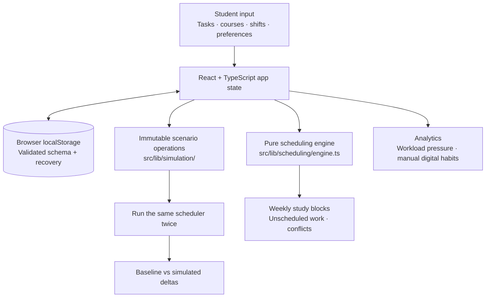
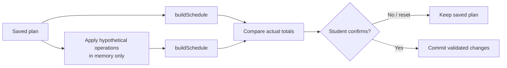

<div align="center">

# 🛡️ SENTINEL 2.0

### Plan for life, not just deadlines.

**A student wellness decision engine that makes the trade-offs behind a busy week visible.**

[**Try the live app**](https://sentinel-2-delta.vercel.app/) · [**Explore the architecture**](docs/ARCHITECTURE.md) · [**Review verification evidence**](docs/FINAL_RELEASE_VERIFICATION.md) · [**See the demo script**](docs/HACKATHON_DEMO.md)

   

**InnovateMU 2026 · Wellness in Tech**

</div>

---

## The decision behind the product

> An extra campus shift opens up. You need the income—but you have an assignment due soon. If you accept the shift, what happens to your study plan?

A conventional calendar shows **what is scheduled**. SENTINEL recalculates **what is feasible after a decision**. It turns assignments, class meetings, work shifts, personal commitments, rest and self-reported digital habits into a weekly plan, then compares that plan with a hypothetical alternative.

**The differentiator:** a scenario is a reversible preview, not an immediate change to the student's real schedule.

## See it in action

**Live application:** https://sentinel-2-delta.vercel.app/

### Product screenshots

Real screenshots from the fictional demo workspace, captured from the running SENTINEL application.

| Overview | Smart Planner |
| :---: | :---: |
|  |  |

| Simulation Lab |
| :---: |
|  |

The **Digital Habits** and **Wellness Insights** views are also available in the live application. Their screenshots will be added here after the corresponding image files are verified in this branch.

### Three-minute demo path

1. Open **Settings → Load demo data**, confirm the fictional Alex Morgan workspace (four courses, nine assignments and sample commitments).
2. Visit **Overview** to see upcoming deadlines, planned study and workload.
3. Open **Smart Planner** to see generated study blocks, fixed commitments and unscheduled demand.
4. In **Simulation Lab**, add a *hypothetical* campus shift, compare **Current** and **Simulated** results, and explain the observed delta. **Reset** to leave the saved plan unchanged.
5. Show **Wellness Insights** and its explicitly nonclinical workload-pressure indicator.

**Important:** A hypothetical shift does not always reduce planned study; it may move work or have no effect. SENTINEL reports the actual computed outcome rather than inventing a dramatic one.

## What students can do

| Workspace | Student-facing capability |
| --- | --- |
| **Overview** | Deadlines, planned study, workload and an actionable insight |
| **Smart Planner** | Manage optional courses, flexible tasks and fixed/recurring commitments; generate feasible study blocks; surface conflicts and unscheduled work |
| **Simulation Lab** | Preview added/removed commitments, deadline changes, study windows, rest and discretionary screen-time changes; confirm before applying |
| **Digital Habits** | Enter screen time manually, track app goals and explore hypothetical discretionary reductions |
| **Wellness Insights** | Understand an explained 0–100 workload-pressure heuristic and intellectual, emotional, financial and physical planning dimensions |
| **Settings & Data** | Five languages, appearance and study preferences, JSON backup/restore, CSV import/export, fictional demo workspace |

## Architecture



**Stack:** React 18, strict TypeScript, Vite 8, Tailwind CSS, Radix UI, Recharts, date-fns and i18next. Vitest/React Testing Library cover logic and components; Playwright tests real Chromium workflows.

The app is a static single-page application deployed on Vercel. It has **no account, server database, external AI API, or automatic device monitoring**. Student data is stored in the current browser profile and site origin; JSON export is the full-workspace backup path.

### The scheduling algorithm

**Source:** [`buildSchedule`](src/lib/scheduling/engine.ts) · [recurrence expansion](src/lib/recurrence.ts) · [architecture detail](docs/ARCHITECTURE.md)

1. Expand weekly recurring commitments into concrete occurrences, respecting exceptions and end dates.
2. Subtract sleep and fixed commitments from each day's preferred study window. Exclude time already past and construct **30-minute scheduling slots**.
3. Cap usable daily study capacity at the lesser of free time and the configured study maximum (plus any explicitly allocated focus-capacity bonus).
4. Select unfinished tasks due within the displayed week **plus seven days of look-ahead**. Sort by **earliest deadline**, then **high → medium → low priority**, then estimated duration.
5. Allocate available slots chronologically, without crossing a task deadline, daily cap or protected commitment. Limit continuous study to **90 minutes**, enforcing the configured breaks, including between different tasks.
6. Permit a shorter final remainder block where appropriate; report every eligible minute that cannot fit as **unscheduled** with an explanation.

**Accounting invariant (for eligible demand):**

```text
remaining(task) = max(0, estimatedMinutes − completedMinutes)
eligible demand = scheduled study minutes + unscheduled study minutes
```

The engine is **deterministic and explainable**, not a globally optimal timetable solver. Free capacity is an upper bound; deadline and break constraints can prevent it from all being used.

### What-if simulation: same engine, two futures



The scenario preview does not mutate the original dataset. The comparison derives planned minutes, unscheduled demand, capacity and conflicts from the two actual engine runs. Screen-time reductions use manually recorded discretionary usage, are capped and require explicit allocation; the app never claims that hypothetical minutes were actually recovered.

### Workload Pressure is not a diagnosis

SENTINEL computes a **0–100 planning heuristic** from five normalized factors:

| Factor | Weight |
| --- | ---: |
| Remaining demand relative to capacity | 40 |
| Unscheduled work | 25 |
| Scheduling conflicts | 15 |
| Long continuous study sessions | 12 |
| Break availability | 8 |

Bands: **Balanced 0–33**, **Elevated 34–66**, **High 67–100**. This is **not** a clinical or psychological assessment. See [implementation and caveats](docs/ARCHITECTURE.md).

## Verification evidence

The independent **8 November 2026 release-candidate audit** recorded:

| Gate | Result |
| --- | --- |
| TypeScript typecheck and production build | **PASS** |
| Unit / integration tests | **150 passed** across 15 files |
| Chromium production-bundle browser tests | **27 passed** |
| Timezone-focused scheduling suites | **91 tests per zone**: UTC, America/Chicago, Asia/Kathmandu |
| Dependency audits | **0 reported vulnerabilities** at verification time |
| Accessibility / responsive checks | Automated axe and keyboard checks; mobile-to-desktop viewport coverage |
| Lint | **Not verified** — no lint script configured |

These are **bounded local test results**, not a guarantee of defect-free behavior. Safari, Firefox, real screen-reader certification and hosted end-to-end verification were outside that audit's scope. Full evidence, exact tested commit, dates and caveats: [`docs/FINAL_RELEASE_VERIFICATION.md`](docs/FINAL_RELEASE_VERIFICATION.md).

## Run locally

**Requires Node.js 22.12+.** No environment variables or API keys are needed.

```bash
npm ci
npm run dev
# Open http://localhost:3000
```

```bash
npm run typecheck
npm test
npm run build
npm run preview
# Browser tests require Chromium installed via Playwright:
npx playwright install chromium
npm run test:e2e
```

Production output is `dist/`; Vercel uses `vercel.json` for client-side route fallback.

## Privacy, limitations and design choices

- **Local-only data:** no login, server backup or cross-device sync. Export a JSON backup before clearing browser data. Local storage is **not encrypted**.
- **Manual digital habits:** SENTINEL does not read actual phone usage. Missing entries mean **unknown**, not zero.
- **Fixed commitments vs flexible tasks:** a work shift occupies a fixed interval; an assignment or personal project requires flexible work time. A course is optional.
- **Honest scheduling:** the chronological heuristic may leave work unscheduled; it does not silently hide impossible plans.
- **Scope:** no Google Calendar/Canvas integration, automatic timetable PDF, iCalendar sync, travel-time engine, drag-and-drop study blocks or offline service worker.
- **Accessibility and languages:** EN, FR, ES, PT and Simplified Chinese; automated checks were run, but native-speaker and assistive-technology reviews remain future work.

Read the [complete supported boundaries](docs/KNOWN_LIMITATIONS.md).

## Engineering documentation

- [System architecture and domain model](docs/ARCHITECTURE.md)
- [Final independent release verification](docs/FINAL_RELEASE_VERIFICATION.md)
- [Development lifecycle and AI-assistance disclosure](docs/DEVELOPMENT_LIFECYCLE.md)
- [Demo and judging walkthrough](docs/HACKATHON_DEMO.md)
- [Known limitations](docs/KNOWN_LIMITATIONS.md)

---

<div align="center">

**Students don't need a perfect-looking plan. They need an honest one.**

[**Launch SENTINEL 2.0**](https://sentinel-2-delta.vercel.app/)

</div>
